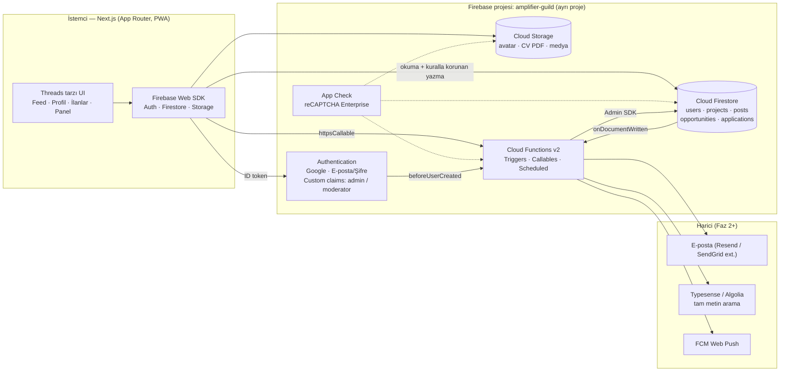
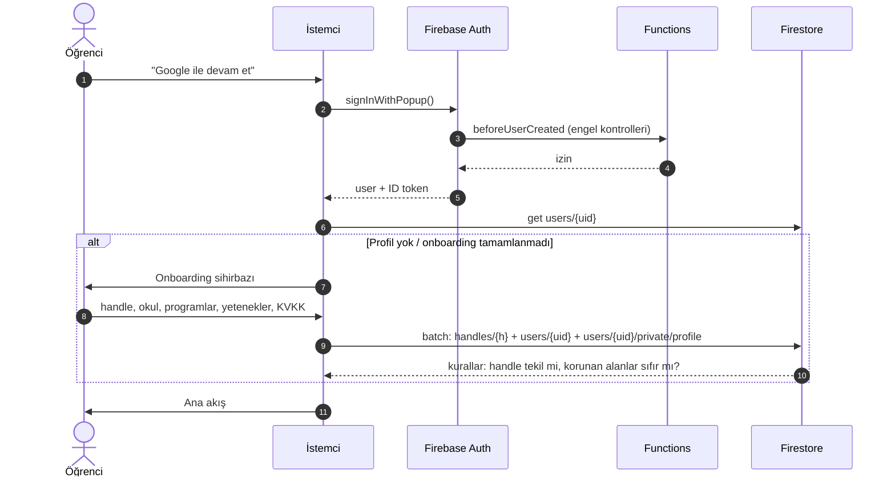
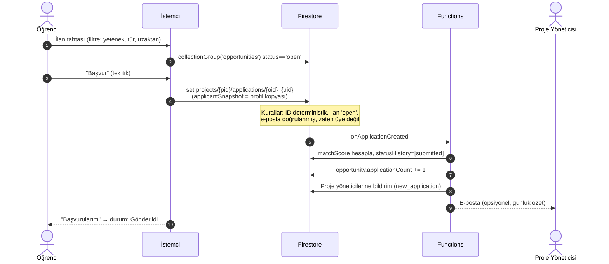
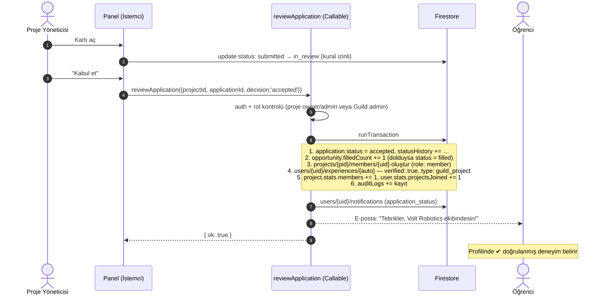

# Amplifier Guild — Mimari Doküman

> **Amplifier Guild**, FRC ve benzeri etkinlik topluluklarındaki öğrencileri; Guild'in kurduğu veya
> anlaştığı girişim ve projelerle buluşturan, onlara insan kaynağı + network + **doğrulanmış CV** kazandıran
> bir lonca platformudur. "Amfi" (okul amfisi) + "Amplifier" (potansiyeli yükselten ses amfisi).

İlgili dokümanlar: [Firestore şeması](FIRESTORE_SCHEMA.md) · [Yol haritası](ROADMAP.md) ·
[Tasarım sistemi](DESIGN_SYSTEM.md) · [Veri modelleri (TS)](../shared/models.ts)

---

## 1. Sistem genel görünümü



### Neden bu dağılım?

| Karar | Gerekçe |
|---|---|
| **Next.js + Firebase Web SDK** (SSR'sız sayfalar ağırlıkta) | Feed gerçek zamanlı (`onSnapshot`); profil `/@handle` ve proje `/p/slug` sayfaları SEO + paylaşım önizlemesi için sunucuda render edilir. |
| **İstemci doğrudan Firestore'a yazar** (basit işlemler) | Gönderi atma, beğenme, profil düzenleme, başvuru → düşük gecikme, sunucu maliyeti yok. Güvenlik `firestore.rules`'ta. |
| **Kritik işlemler Callable Function** | Başvuru kabul/ret, proje onayı, rol atama — birden fazla belgeyi atomik değiştirir, istemciye güvenilmez. |
| **Sayaçlar trigger ile** | `likeCount`, `applicationCount` vb. istemciden yazılırsa manipüle edilir. |
| **Ayrı Firebase projesi + ayrı domain** | bumpermedia.online'dan bağımsız auth havuzu, kota, faturalandırma, KVKK sorumluluğu. Alan adı: **amplifierguild.online**. |
| **Hosting: Vercel** (`amplifierguild` projesi) | GitHub repo bağlı: her push otomatik deploy (production + PR önizlemeleri). Next.js uygulaması repo kökünde. Firebase sadece backend (Auth, Firestore, Functions, Storage). |

---

## 2. Çekirdek modüller

### 2.1 Auth & Profil Modülü

**Sorumluluk:** Kimlik, onboarding, yetenek profili (public CV), hassas veri, KVKK.

| Bileşen | Detay |
|---|---|
| Giriş yöntemleri | Google (öğrenciler için en hızlı) + E-posta/Şifre (e-posta doğrulaması zorunlu: gönderi/başvuru kuralları `email_verified` ister) |
| `beforeUserCreated` (blocking) | Disposable e-posta engeli, rate-limit; isteğe bağlı okul domain beyaz listesi |
| Onboarding sihirbazı (4 adım) | ① Kullanıcı adı + ad + fotoğraf → ② Okul + doğum tarihi (18 yaş altıysa veli onayı adımı) → ③ Programlar (FRC #takım, sezonlar, rol) + yetenek etiketleri → ④ KVKK onayı + `openToWork` |
| Profil sayfası `/@handle` | Başlık, rozetler, programlar, yetenekler, **Deneyimler (CV)** — doğrulanmış kalemler ✔ işaretli. Sekmeler: Gönderiler · Yanıtlar · CV |
| CV dışa aktarma | Profil verisinden PDF (istemcide `@react-pdf/renderer`) — "Guild doğrulamalı CV" |
| Rol yönetimi | Custom claims (`admin`, `moderator`) sadece `setUserRole` callable ile; claim değişince istemci `getIdToken(true)` yeniler |



### 2.2 Ana Sayfa (akış yerine)

> **Karar (2026-11):** Forum / Threads tarzı akış **kapsam dışı**. Site yalnızca eşleştirme sistemidir.
> `posts` koleksiyonu, kuralları, indeksleri ve tetikleyicileri kaldırıldı.

`/ana-sayfa` kişisel bir panodur: profil doluluk oranı, son başvuruların durumu ve uyum skoruna göre
en uygun 3 ilan. Proje duyuruları gerekirse ileride proje sayfasında basit bir "güncellemeler" listesi olarak eklenir.

### 2.3 İlan ve Eşleştirme Tahtası (Job Board)

**Sorumluluk:** Açık pozisyonlar, filtreleme, tek tıkla başvuru, eşleştirme skoru, "Başvurularım".

**Tek tık başvuru nasıl mümkün?** Profil zaten CV'dir. "Başvur" butonu → (ilan ek soru içermiyorsa) onay
modalı → `applicantSnapshot` profil verisinden otomatik doldurulur → tek `set()`.

**Eşleştirme skoru** (`onApplicationCreated` içinde, 0–100):

```
required   = opportunity.requiredSkillSlugs
nice       = opportunity.niceToHaveSkillSlugs
have       = applicant.skillSlugs

skillScore = 70 · |have ∩ required| / max(|required|, 1)
niceScore  = 15 · |have ∩ nice| / max(|nice|, 1)
progScore  = 10 if applicant has any FRC/FTC/TEKNOFEST entry else 0
availScore =  5 if availability.hoursPerWeek ≥ commitment.hoursPerWeek else 0
matchScore = round(skillScore + niceScore + progScore + availScore)
```

Ayrıca öğrenci tarafında ilan listesinde "**Sana %80 uygun**" rozeti istemcide aynı formülle hesaplanır
(sunucuya gitmeden). Faz 2: `openToWork` öğrencilere yeni ilan açıldığında skor ≥ 60 ise bildirim.



### 2.4 Yönetim Paneli

İki seviyeli panel:

| Panel | Kim | Ekranlar |
|---|---|---|
| **Proje Paneli** `/p/{slug}/manage` | Proje `owner`/`admin` | İlanlar (taslak/açık/kapalı) · Başvuru kanban'ı · Ekip · Proje ayarları |
| **Guild Admin** `/admin` | `admin` claim | Proje onay kuyruğu · Tüm başvurular (yönetici atıl kalan ilanlar) · Moderasyon (şikâyetler) · Kullanıcı & rozet yönetimi · Metrikler · Audit log |

**Başvuru kanban'ı:**

```
 Yeni (submitted) │ İnceleniyor │ Kısa liste │ Kabul ✔ │ Ret ✖
 ─────────────────┼─────────────┼────────────┼─────────┼──────
 [Ayşe · %86]     │ [Mert · %72]│ [Zeynep]   │         │
 [Can · %64]      │             │            │         │
```
Kart açılınca: başvuru anındaki CV snapshot'ı, cevaplar, matchScore dökümü, iç notlar
(`internal/review` — başvuran göremez), zaman çizelgesi.



Ret kararında sadece 1 + bildirim + audit log çalışır. İlan `filled` olduğunda kalan `submitted`/`in_review`
başvurular için opsiyonel toplu "nazik ret" (`closeOpportunity` callable).

---

## 3. Cloud Functions kataloğu

| Fonksiyon | Tür | Tetik / Girdi | İş |
|---|---|---|---|
| `beforeUserCreated` | Blocking auth | Kayıt | Disposable e-posta/abuse engeli |
| `onUserUpdated` | Firestore trigger | `users/{uid}` | Ad/foto değiştiyse snapshot'ları yay; `skillSlugs` normalize et |
| `onFollowWritten` | Trigger | `users/{uid}/following/{t}` | `followers` aynası + `stats` sayaçları + bildirim |
| `onPostCreated` | Trigger | `posts/{id}` | Sayaçlar, yanıt sayısı, mention bildirimleri, link önizleme, (Faz 2) fan-out |
| `onPostDeleted` | Trigger | `posts/{id}` | Sayaç geri al, alt `likes` temizliği |
| `onLikeWritten` | Trigger | `posts/{id}/likes/{uid}` | `likeCount` ±1, bildirim (kendine değilse) |
| `onOpportunityWritten` | Trigger | `projects/{pid}/opportunities/{oid}` | `draft→open` olunca akışa `opportunity` gönderisi üret; `project.stats.openOpportunities` |
| `onApplicationCreated` | Trigger | `projects/{pid}/applications/{aid}` | `matchScore`, `applicationCount`, `statusHistory`, yöneticilere bildirim |
| `onApplicationUpdated` | Trigger | aynı | `in_review`/`withdrawn` geçişlerini `statusHistory`'ye ekle |
| **`reviewApplication`** | Callable | `{projectId, applicationId, decision}` | Kabul/ret/kısa liste transaction'ı (bkz. 2.4) |
| **`reviewProject`** | Callable (admin) | `{projectId, decision}` | `pending→active/rejected`, sahibine bildirim |
| **`setUserRole`** | Callable (admin) | `{uid, role}` | Custom claims + audit |
| `getApplicantContact` | Callable | `{projectId, applicationId}` | Sadece `accepted` ise başvuranın e-postasını yöneticiye döner |
| `deleteMyAccount` | Callable | — | KVKK silme: profil anonimleştir, private sil, Auth sil |
| `closeExpiredOpportunities` | Scheduled (her saat) | — | `deadline < now` olan `open` ilanları `closed` |
| `dailyDigest` | Scheduled (her gün 09:00 TR) | — | Yöneticilere bekleyen başvuru özeti e-postası |

Kod iskeleti: [`functions/src/index.ts`](../functions/src/index.ts)

---

## 4. Frontend mimarisi

```
/ (repo kökü)                   (Next.js 15, TypeScript, saf CSS tokenları — Vercel kökten derler)
├─ app/
│  ├─ (auth)/login/             giriş
│  ├─ (auth)/onboarding/        4 adımlı sihirbaz
│  ├─ (main)/layout.tsx         Threads iskeleti: sol ikon rayı (desktop) / alt bar (mobil)
│  ├─ (main)/page.tsx           Ana akış  [Senin için | Takip]
│  ├─ (main)/post/[id]/         Thread detayı
│  ├─ (main)/@[handle]/         Profil (rewrite: /@ayse → /u/ayse)
│  ├─ (main)/p/[slug]/          Proje sayfası
│  ├─ (main)/p/[slug]/manage/   Proje paneli (ilanlar, başvuru kanban, ekip)
│  ├─ (main)/jobs/              İlan tahtası  /jobs/[pid]/[oid] ilan detayı
│  ├─ (main)/me/applications/   Başvurularım
│  ├─ (main)/notifications/
│  └─ admin/                    Guild admin (claim guard)
├─ components/  feed/ post/ profile/ jobs/ admin/ ui/
├─ lib/firebase/  client.ts (init + App Check)  converters.ts (tipli withConverter)
├─ lib/queries/   feed.ts  jobs.ts  applications.ts  (tüm Firestore sorguları tek yerde)
├─ lib/match.ts   eşleştirme skoru (Functions ile paylaşılan saf fonksiyon)
└─ hooks/         useAuth  useProfile  useFeed (sonsuz kaydırma)  useClaims
shared/models.ts  ← Functions ile ortak tipler
```

**Durum yönetimi:** TanStack Query (cache + sayfalama) + Firestore `onSnapshot` sadece gerçek zamanlı
gereken yerlerde (açık thread, bildirim sayacı, kanban). Global state için Zustand (auth/claims).

---

## 5. Güvenlik, KVKK ve kalite

- **KVKK / reşit olmayanlar:** Kullanıcıların çoğu 14–18 yaş. Aydınlatma metni + açık rıza, 18 yaş altı için
  veli e-posta onayı, hassas alanlar `private/` altında, iletişim bilgisi sadece kabul sonrası paylaşılır,
  hesap silme callable'ı. Veri konumu: Firestore bölgesi **`europe-west3` (Frankfurt)** veya `eur3`.
- **App Check** (reCAPTCHA Enterprise) Firestore, Functions ve Storage'da zorunlu.
- **Kurallar testi:** `@firebase/rules-unit-testing` ile her kural için pozitif/negatif test (CI'da emülatörle).
- **Rate limit:** Gönderi/başvuru için Function tarafında kullanıcı başına sayaç (`users/{uid}/private/limits`);
  şüpheli hesap → `badges: ['restricted']`.
- **Moderasyon:** Şikâyet → `reports` → admin panel → `posts.status = hidden/removed`.
- **Gözlemlenebilirlik:** Functions logları (Cloud Logging), Crashlytics yerine Sentry (web), Firebase Analytics
  ile huni: kayıt → onboarding → ilk başvuru → kabul.
- **Yedek:** Firestore PITR (point-in-time recovery) + haftalık zamanlanmış export.

---

## 6. Ölçek ve maliyet notları

- Okumalar maliyetin ana kalemi: feed sayfası 20 belge; snapshot denormalizasyonu sayesinde ek okuma yok.
- `onSnapshot` dinleyicilerini sadece görünür ekranda tut; feed için sayfalı `getDocs` + "yeni gönderiler" banner'ı
  (en yeni 1 belgeyi dinle).
- Sayaçlarda hot-spot riski (popüler gönderi > 1 yazma/sn) Faz 2'de dağıtık sayaç (sharded counter) ile çözülür.
