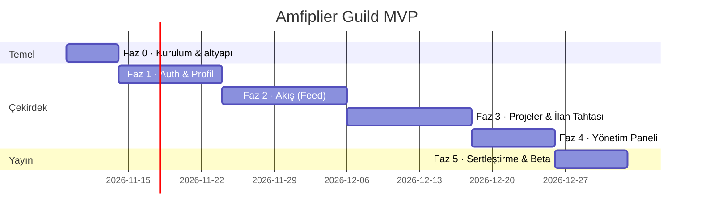

# Adım Adım Uygulama Rehberi (Yol Haritası)

> Hedef: ~10 haftada canlıya çıkan bir MVP. Her faz kendi başına deploy edilebilir ve
> bir öncekinin üzerine kurulur. Süreler 1–2 kişilik ekip için tahminidir.



---

## Faz 0 — Kurulum ve altyapı (≈ 1 hafta)

- [ ] **Firebase projesi** oluştur: `amfiplier-guild-prod` + `amfiplier-guild-dev` (ayrı ortamlar).
      Firestore bölgesi: `europe-west3` (KVKK + Türkiye'ye yakın gecikme). *Bölge sonradan değiştirilemez.*
- [ ] Auth sağlayıcıları: Google + E-posta/Şifre. E-posta doğrulama şablonunu Türkçeleştir.
- [ ] **App Check** (reCAPTCHA Enterprise) — önce *monitor* modda, Faz 5'te *enforce*.
- [ ] Repo yapısı: `apps/web` (Next.js 15 + TS + Tailwind), `functions/`, `shared/`, `tests/`.
- [ ] `firebase.json`, `firestore.rules`, `firestore.indexes.json`, `storage.rules` (bu repoda hazır).
- [ ] Yerel geliştirme: `npm run emulators` → Auth + Firestore + Functions + Storage emülatörleri.
- [ ] CI (GitHub Actions): PR'da `npm run test:rules` + `functions` tsc + web lint/build.
      `main`'e merge → dev ortamına deploy; tag → prod.
- [ ] Hosting: **Firebase App Hosting** (Next.js SSR) ve alan adı (ör. `guild.bumpermedia.online` CNAME
      ya da ayrı domain). bumpermedia.online ile sadece link/ortak marka paylaşılır, kod ve auth ayrı.
- [ ] Tasarım tokenları + temel UI bileşenleri ([DESIGN_SYSTEM.md](DESIGN_SYSTEM.md)): Button, Avatar,
      PostCard iskeleti, BottomNav/SideRail, Sheet (mobil alt panel), Skeleton.

**Çıktı:** Boş ama deploy edilmiş, logolu, koyu temalı kabuk uygulama.

## Faz 1 — Auth & Profil (≈ 2 hafta)

- [ ] `lib/firebase/client.ts`: init, App Check, `withConverter` tipli referanslar (`shared/models.ts`).
- [ ] `useAuth` + route guard'ları: giriş yoksa `/login`, `onboardingComplete=false` ise `/onboarding`.
- [ ] **Onboarding sihirbazı** (4 adım) — son adımda tek `writeBatch`: `handles/{h}` + `users/{uid}` + `private/profile`.
      Handle müsaitlik kontrolü: `getDoc(handles/{h})` (debounce 300ms).
- [ ] 18 yaş altı akışı: doğum tarihi → `isMinor` → veli adı/e-postası + onay kutusu. KVKK aydınlatma metni sayfası.
- [ ] **Profil sayfası** `/@handle` (SSR + OG image): başlık, programlar (FRC #takım rozetleri),
      yetenekler, Deneyimler (✔ doğrulanmış kalemler), sekmeler.
- [ ] Profil düzenleme + deneyim CRUD (sürükle-bırak `order`). Avatar yükleme (istemcide 512px'e küçült).
- [ ] `meta/taxonomy` → yetenek etiketi autocomplete (`toSlug` ile normalize).
- [ ] Functions: `beforeUserCreated`, `onUserUpdated` (snapshot yayılımı), `setUserRole`, `deleteMyAccount`.
- [ ] İlk admin'i atamak için tek seferlik script (`scripts/grant-admin.ts`, Admin SDK).

**Kabul kriteri:** Yeni kullanıcı 2 dakikada kayıt olup paylaşılabilir CV linkine sahip olur.

## Faz 2 — Akış / Threads tarzı Feed (≈ 2,5 hafta)

- [ ] Composer: 500 karakter sayacı, ≤4 görsel, proje adına paylaşım seçici, iyimser (optimistic) ekleme.
- [ ] `PostCard`: yazar satırı, metin (link/mention/hashtag parse), medya ızgarası, aksiyon satırı, thread çizgisi.
- [ ] Ana akış: "Senin için" + "Takip" sekmeleri, sonsuz kaydırma (`startAfter`), "N yeni gönderi" banner'ı.
- [ ] Thread detayı `/post/[id]`: kök + `rootId` ile yanıtlar (kronolojik), yanıt yazma.
- [ ] Beğeni (iyimser toggle, `likes/{uid}`), takip et/bırak (kullanıcı + proje).
- [ ] Bildirimler sayfası + üst bardaki okunmamış sayacı (`onSnapshot`, `where read==false`, `limit 20`).
- [ ] Şikâyet et → `reports`.
- [ ] Functions: `onPostCreated`, `onPostDeleted`, `onLikeWritten`, `onFollowWritten`.

**Kabul kriteri:** 20 gönderilik sayfa ≤ 21 belge okuması ile çizilir; beğeni sayacı manipüle edilemez (kural testi).

## Faz 3 — Projeler & İlan Tahtası (≈ 2,5 hafta)

- [ ] Proje önerme formu → `pending` (sahip üyeliğiyle tek batch). Proje sayfası `/p/[slug]` (akış + ekip + açık ilanlar).
- [ ] İlan oluşturma formu (proje paneli): yetenekler, kontenjan, tür, süre, ≤3 ek soru, son tarih, taslak/yayın.
- [ ] **İlan tahtası** `/jobs`: collection group sorgusu, filtre çipleri (yetenek, tür, uzaktan),
      her kartta istemci tarafı "Sana %X uygun" (`shared/match.ts`).
- [ ] **Tek tık başvuru**: ek soru yoksa onay sheet'i → `setDoc(applications/{oid}_{uid})`.
      Profil eksikse (yetenek yok vb.) önce tamamlamaya yönlendir.
- [ ] "Başvurularım" `/me/applications`: durum zaman çizelgesi, geri çekme.
- [ ] İlan yayınlanınca akışa `opportunity` gönderisi (kartta "Başvur" butonu).
- [ ] Functions: `onApplicationCreated` (skor + sayaç + bildirim), `onOpportunityWritten`, `closeExpiredOpportunities`.

**Kabul kriteri:** Profili olan öğrenci ilan detayından 2 tıkta başvurur; aynı ilana ikinci başvuru imkânsız.

## Faz 4 — Yönetim Paneli (≈ 1,5 hafta)

- [ ] **Proje paneli** `/p/[slug]/manage`: ilan listesi, başvuru **kanban**'ı (sütunlar = durumlar,
      kart = snapshot + skor), kart detayı (CV, cevaplar, iç notlar `internal/review`, zaman çizelgesi).
- [ ] Karar butonları → `reviewApplication` callable (kısa liste / kabul / ret + başvurana mesaj).
- [ ] Kabul sonrası "İletişim bilgisini göster" → `getApplicantContact`.
- [ ] **Guild admin** `/admin` (claim guard + sunucu tarafında da kontrol):
      proje onay kuyruğu (`reviewProject`), bekleyen başvurular (atıl kalan ilanlar), şikâyetler/moderasyon,
      kullanıcı arama + rozet/rol atama, audit log, temel metrikler (kayıt, başvuru, kabul oranı).
- [ ] `dailyDigest` e-postası (Firebase "Trigger Email" extension veya Resend).

**Kabul kriteri:** Kabul edilen öğrencinin profilinde ✔ doğrulanmış "Guild Projesi" deneyimi otomatik görünür.

## Faz 5 — Sertleştirme ve beta (≈ 1 hafta)

- [ ] App Check *enforce*, rate-limit, Storage boyut limitleri gözden geçirme.
- [ ] Kural testleri kapsamını tüm koleksiyonlara genişlet; Functions için emülatör entegrasyon testleri.
- [ ] Lighthouse ≥ 90 (mobil), PWA manifest + ikonlar (logo), OG görselleri.
- [ ] Firestore PITR + zamanlanmış yedek, bütçe alarmı (Billing alert).
- [ ] KVKK: aydınlatma metni, açık rıza, veri silme talebi akışı, çerez bildirimi.
- [ ] **Kapalı beta:** 2–3 FRC takımı + 2 pilot proje. Huni metrikleri: kayıt → onboarding → ilk başvuru → kabul.

---

## Faz 6+ (MVP sonrası)

| Özellik | Not |
|---|---|
| Fan-out timeline + sıralama skoru | Kullanıcı > ~5k olunca ([ARCHITECTURE.md §2.2](ARCHITECTURE.md)) |
| Tam metin arama | Typesense/Algolia extension: kullanıcı, proje, ilan |
| Web push (FCM) | Başvuru durumu ve yeni eşleşen ilan bildirimleri |
| Proje içi görev panosu / mentorluk | Kabul edilen ekiplerin çalışma alanı |
| Referans (endorsement) sistemi | Proje yöneticisi, ekip üyesinin yeteneklerini onaylar → CV'de güçlü sinyal |
| Etkinlik takvimi | FRC bölgesel yarışmalar, Guild buluşmaları |
| Mobil uygulama | PWA yeterli değilse Expo / React Native (aynı Firebase backend) |

## Hızlı başlangıç komutları

```bash
npm install                       # kök: firebase-tools + kural testi bağımlılıkları
(cd functions && npm install)
npm run emulators                 # http://localhost:4000 emülatör arayüzü
npm run test:rules                # Firestore kural testleri (emülatörde)
(cd functions && npm run build)   # Functions derleme
firebase deploy --only firestore:rules,firestore:indexes,storage,functions --project <proje-id>
```
